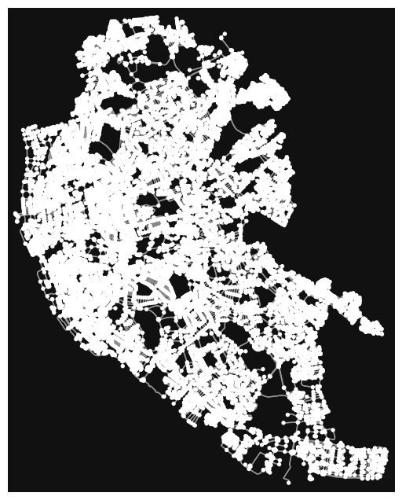
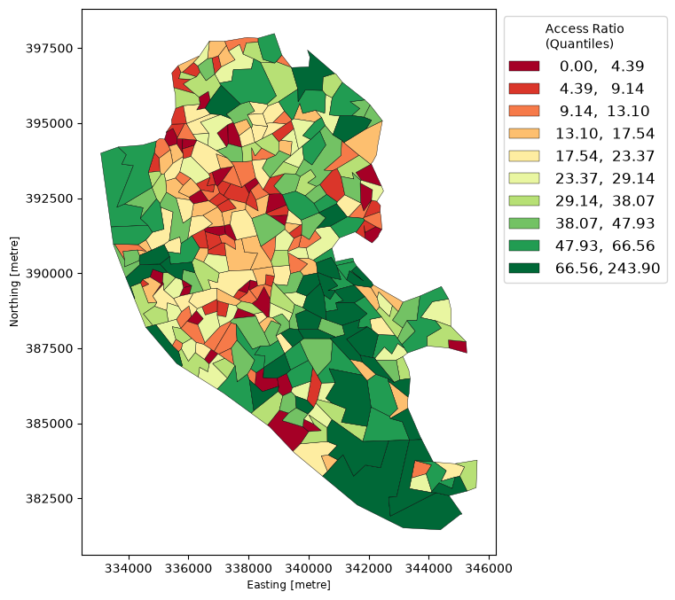
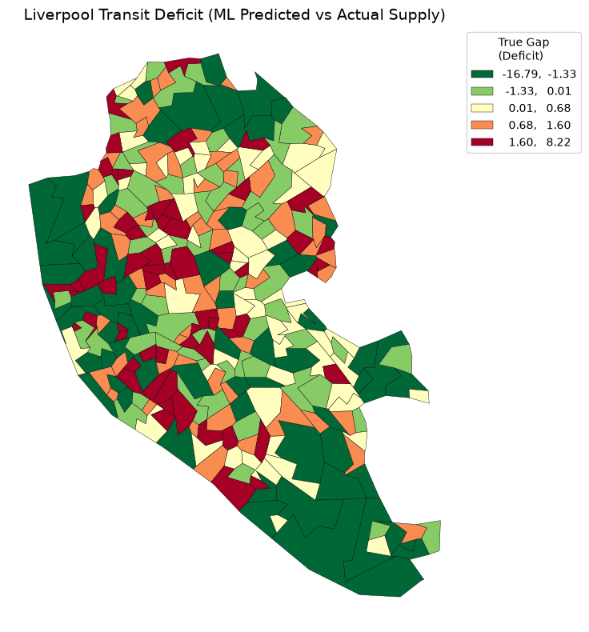

This is currently version 0.1.0 of mapping public transport availability in Liverpool City Reigon.
So far we have processed map data from OSMNX, and supply/demand data from the UK government.

We find LSOA (Lower layer Super Output Areas) boundaries, and consider various demand factors.
Currently these factors are total number of households in the area, and number of households with no access to a car or van.
The supply factor we are considering is total number of public transport nodes, listed as bus stop or train station.

We first map the ratio of nodes per 1000 households with no car access.

We then train a ML model to predict the number of nodes in a LSOA, and compare that number to the actual number of nodes. We call this value the 'True Gap' and finally map this to find out which areas are over/underrepresented in transport accessability.

